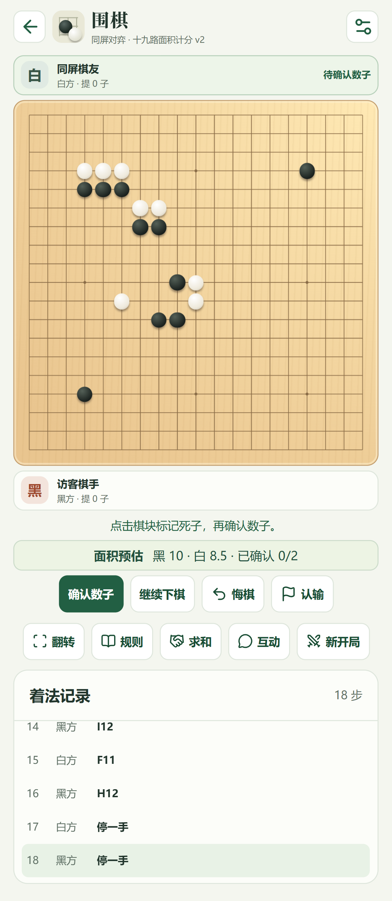
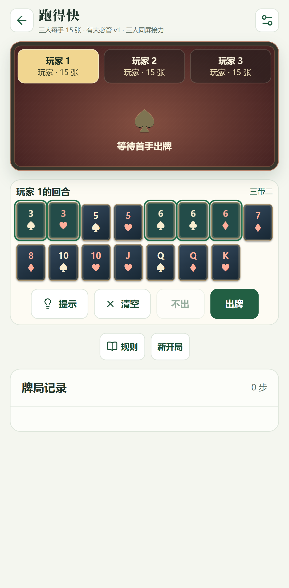

# 棋魂 Qihun

以中国象棋为主的离线棋牌应用。支持同屏对弈、人机练习和本地复盘，包含 9 种棋、3 种牌与 137 段离线普通话报音。

**v0.5.0 · 首次 GitHub 发行** · [查看发行说明与 Android 试装包](https://github.com/lyx0415/qihun/releases/tag/v0.5.0)

<p>
  
  
  
</p>

## 可玩内容

| 类别 | 玩法 | 对局方式 |
| --- | --- | --- |
| 棋类 | 中国象棋、五子棋、围棋、国际象棋、斗兽棋、象棋翻棋、黑白棋、英式跳棋 | 双人同屏或人机 |
| 多人棋 | 飞行棋 | 2–4 人同屏，或一人对 1–3 台电脑 |
| 牌类 | 三人斗地主、15／16 张跑得快、四人锄大地 | 一人对电脑或同屏接力，交接时隐藏手牌 |

- 本地棋手档案分别保存续局和历史对局，音画偏好也保存在本机。棋谱与牌谱支持拖动、跳步、0.5／1／2 倍速播放及 JSON 导出。
- 棋桌提供悔棋、认输、翻转和合法着法提示。双人同屏可以求和，牌桌提供合法出牌提示、清空选牌与三档电脑难度。
- 普通话覆盖走棋、吃子、将军、打吃、掷骰、叫分、牌型和结算。可选择完整报音或仅关键事件，分别调节语音、音效和三首原创配乐。
- 棋盘支持原木、青玉和落子轨迹。斗兽棋可切换动物插画与文字棋子，扑克牌可切换象牙白与墨蓝。

## 本地运行

需要 Node.js 20.19+ 或 22.12+。建议使用维护中的 Node.js LTS 版本。

```powershell
git clone https://github.com/lyx0415/qihun.git
cd qihun
npm ci
npm run dev
```

浏览器打开 `http://127.0.0.1:5173`。网页端以 React、TypeScript 和 Vite 构建，规则与界面分离。Android 端以 Capacitor 打包，对局和设置在设备本地保存。

生产构建和验收命令如下。

```powershell
npm test
npm run build
npx playwright install chromium
npm run test:e2e
```

Windows 也可把 `PLAYWRIGHT_CHROMIUM_EXECUTABLE` 指向现有 Edge 程序并直接运行端到端测试。生产文件输出到 `dist`，可以用 `npm run preview` 检查，网页文件也可放在任意静态 HTTPS 站点中。

## Android 试装和打包

试装包见 [GitHub Releases](https://github.com/lyx0415/qihun/releases)。如需自行构建，安装 JDK 21、Android SDK Platform 36 与 Build Tools 36.0.0。通过 `ANDROID_HOME` 或 Android Studio 配置 SDK 目录，在项目根目录运行以下命令。

```powershell
npm run android:sync
Push-Location android
try { .\gradlew.bat assembleDebug } finally { Pop-Location }
```

APK 输出在 `android/app/build/outputs/apk/debug/app-debug.apk`，应用包名为 `com.qihun.board`。需要 Android 7.0 或以上以及支持现代网页特性的 Android System WebView。发行附件使用调试签名，供试装。v0.5.0 通过 34 项规则测试和 40 项浏览器端到端测试，已验证 APK 签名及离线资源，Android 真机听感和帧率待实测。

## 规则范围

- 中国象棋支持任选一方开局让一马、一车、一炮或双马，三次重复盘面或连续 120 个半回合无吃子判和。长将长捉的赛事裁决待另行实现。
- 围棋支持 9／13／19 路、白贴半目／5.5／7.5 目、固定 2–4 子。任选双方确认数子，双方停手后可标记死子和恢复行棋。围棋电脑可确认数子方案，死活及争议由玩家判定。
- 五子棋支持 11／15／19 路与至少五连、恰好五连。恰五玩法可下长连。国际象棋由 `chess.js` 判定合法动作和常见结局。
- 飞行棋支持 2–4 队同屏，或一名玩家加 1–3 名电脑。可自选两架快局、起飞点数、终点反弹和同色跳跃。旧双人飞行棋档案沿用原设定。
- 黑白棋按经典 8×8 起始局面运行，允许无着法时跳过，并以终局盘面数子。翻棋采用应用内说明的双人规则。
- 英式跳棋有吃必吃，普通棋子只向前跳。连续跳吃必须由同一枚棋完成，升王结束回合。
- 锄大地采用方块 3 首出、方块至黑桃的花色顺序、五张牌内部比较。完整规则在牌桌内可查看。
- 人机使用轻量规则搜索或启发式。翻棋人机根据已公开局面选择动作，飞行棋人机由骰子与公开状态驱动。
- 设备档案、设置和对局记录保存在本机。同屏短消息只显示在当前棋桌。

## 路线图与素材

长期目标是覆盖 2–6 人桌型和 30 个经过验收的规则包。分阶段加入残局题库、番棋、掼蛋和地区牌类，再扩展好友房、断线续局、全国匹配、云端棋谱和微信适配。

- [棋魂长期目标](docs/棋魂长期目标.md)
- [产品与技术计划](docs/产品与技术计划.md)
- [牌类调研与实现](docs/牌类调研与实现.md)
- [图赏、语音及配乐素材](docs/素材说明.md)
- [第三方依赖许可](public/THIRD-PARTY-NOTICES.txt)与[Noto Serif SC 字体许可](public/art/Noto-Serif-SC-OFL.txt)
